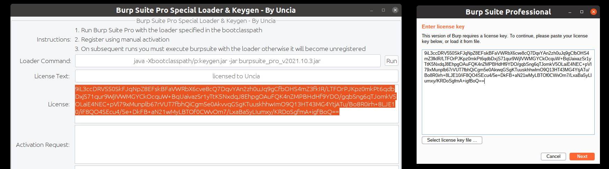
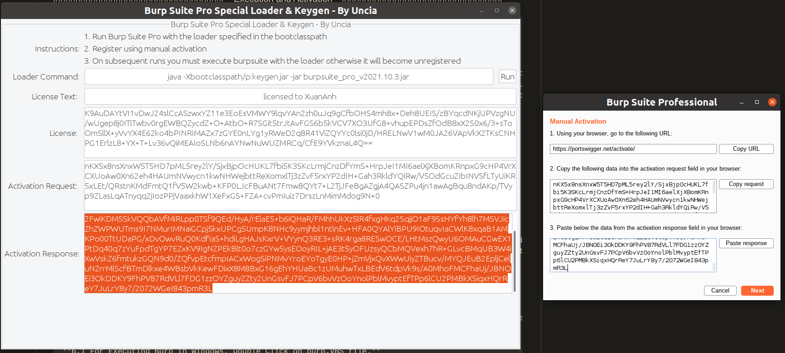
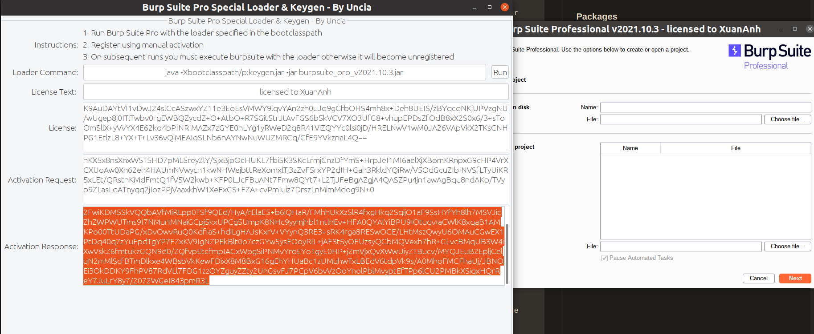

> Download links point to the private [softwares repository](https://github.com/alexander1307xa/softwares). Sign in to GitHub with an account that has access; otherwise the links may return 404.


# Burp Suite Professional Installation Guide

## Download Files

Download the required files from the [GitHub Release](https://github.com/alexander1307xa/softwares/releases/tag/burpsuite-pro-2021.10.3):

- [burpsuite_pro_v2021.10.3.jar](https://github.com/alexander1307xa/softwares/releases/download/burpsuite-pro-2021.10.3/burpsuite_pro_v2021.10.3.jar) - Main application
- [keygen.jar](https://github.com/alexander1307xa/softwares/releases/download/burpsuite-pro-2021.10.3/keygen.jar) - License key generator
- [loader.jar](https://github.com/alexander1307xa/softwares/releases/download/burpsuite-pro-2021.10.3/loader.jar) - Application loader

## Installation Requirements

- Java Runtime Environment (JRE) 8 or higher
- Verify Java installation:
```bash
java -version
```

## How to Install

1. Download all three files from the release page
2. Place them in the same directory
3. Run the loader:
```bash
java -jar loader.jar
```

## How to Use Keygen

Follow these steps to generate and activate your license:

### Step 1: Run Keygen


Run the keygen to generate a license key:
```bash
java -jar keygen.jar
```

### Step 2: Copy License Key


Copy the generated license key from the keygen window.

### Step 3: Activate License


Paste the license key into Burp Suite Pro when prompted and complete the activation process.
